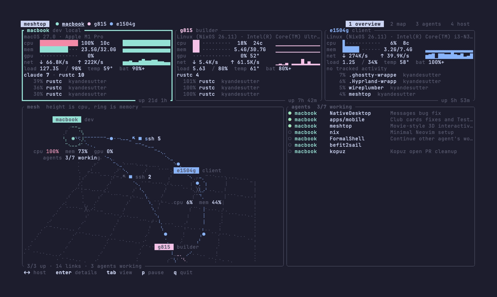

# meshtop

Live resource usage, connections and coding agents across all your machines,
in one terminal.

meshtop runs `meshtop agent` on every host over ssh and draws what comes back:
a card per machine, a map of who is connected to whom, and every coding agent
running anywhere, with the ones waiting for input at the top. There is no
daemon and no open port; if you can `ssh host` without a password prompt,
meshtop can watch it.



```
 laptop (TUI)                         each host
┌────────────────┐   ssh, JSON lines  ┌───────────────────────────┐
│ meshtop        │ ◀───────────────── │ meshtop agent --interval 1│
│ cards, map,    │                    │ sysinfo, sockets, GPU,    │
│ agents         │                    │ herdr agent list          │
└────────────────┘                    └───────────────────────────┘
```

The machine meshtop runs on is sampled in process instead.

## What it shows

| | |
|---|---|
| CPU, per core, load | usage with history, core grid in the host view |
| Memory, swap | used of total, history |
| GPU | NVIDIA through `nvidia-smi`, AMD through sysfs, Apple Silicon through IORegistry |
| Network | rates per interface, total over physical links |
| Disks, temperatures, battery | per mount, hottest sensors, charge and power source |
| Processes | top by CPU or memory, with user and command line |
| Activity | counts per rule: running nix builds, builds served, rustc, mosh sessions, your own |
| Agents | Claude, Codex and other coding agents, with state and task title from Herdr, or by process outside it |
| Mesh | TCP links between your hosts, labelled ssh, nix build, syncthing, rdp, http or your own port names |
| Plan usage | 5 hour and weekly limits of each signed-in Claude Code and Codex account |

The map is a 3D scene you can turn. Hosts stand on a grid, raised by their
CPU load, with a ring that fills with memory use. Links run from client to
server with one moving dot per kind of traffic. Drag to turn it, scroll to
zoom; it spins slowly until you touch it, and selecting a host turns it to
the front.

A remote nix build shows up as a `nix build` link from the machine that asked
for it to the builder. Both ends of a connection are merged into one link, so
the map is complete even where one side cannot see the socket's owner (macOS
hides root's sockets from other users).

## Install

### Nix

```
nix run github:FormalSnake/meshtop
```

### Home Manager

```nix
{
  inputs.meshtop = {
    url = "github:FormalSnake/meshtop";
    inputs.nixpkgs.follows = "nixpkgs";
  };

  # in your home configuration
  imports = [ inputs.meshtop.homeModules.default ];

  programs.meshtop = {
    enable = true;
    hosts = [
      { name = "macbook"; role = "dev"; hostname = "MacBook-Pro-2"; }
      { name = "g815"; role = "builder"; }
      { name = "e1504g"; role = "client"; }
    ];
    ports."1234" = "bluebubbles";
    usage = [
      { kind = "claude"; name = "personal"; }
      { kind = "claude"; name = "work"; dir = "~/.claude-work"; }
      { kind = "codex"; }
    ];
  };
}
```

Import the module on every host you list: the remote side needs the binary,
and the agent reads its activity rules from the same config. The default
remote command is the absolute path under `home.profileDirectory`, so a
non-interactive ssh shell with a short `PATH` still finds it.

### Cargo

Needs Rust 1.88+.

```
cargo install --git https://github.com/FormalSnake/meshtop
```

## Usage

```
meshtop                  # the TUI
meshtop hosts            # config path, and how each host is reached
meshtop snapshot         # one reading of this machine, pretty JSON
meshtop agent -i 1       # JSON lines on stdout, what the TUI runs over ssh
```

| Key | |
|---|---|
| `1` `2` `3` `4`, `tab` | overview, map, agents, host |
| `←` `→`, `h` `l` | select host |
| `enter` | open the selected host |
| `↑` `↓`, `j` `k` | scroll processes or agents, tilt the map |
| `+` `-` | zoom the map |
| `r` | stop or start the map spinning, and reset the tilt |
| `s` | sort processes by CPU or memory |
| `p`, `space` | pause |
| `esc` | back, or quit from the overview |
| `q` | quit |

The mouse works too: click a host anywhere (header, card, map node, agent row)
to select it, click it again to open it, click the tabs, scroll lists with the
wheel, drag the map to turn it.

## Config

`$XDG_CONFIG_HOME/meshtop/config.toml`, which the Home Manager module writes.
Without one, meshtop shows only the machine it runs on.

```toml
interval = 1.0   # seconds between samples
history = 120    # samples kept for the graphs

[[hosts]]
name = "macbook"            # shown in the TUI, and the ssh destination
ssh = "kyan@100.75.60.102"  # optional, when the destination differs
command = "meshtop"         # optional, meshtop on the remote side
role = "dev"                # optional, shown next to the name
hostname = "MacBook-Pro-2"  # optional, the machine's own hostname

[[activity]]                 # replaces the built-in rules when present
label = "nix build"
user = "nixbld"              # with user set, distinct users are counted

[[activity]]
label = "xcodebuild"
name = ["xcodebuild"]        # exact process names
# cmd = "nix-daemon --stdio" # or a command line substring

[ports]
"1234" = "bluebubbles"

[[usage]]                    # replaces the default ~/.claude and ~/.codex
kind = "claude"              # or "codex"
name = "work"                # optional, defaults to the dir name
dir = "~/.claude-work"       # CLAUDE_CONFIG_DIR or CODEX_HOME
```

Plan usage is read on the machine the TUI runs on, once a minute, and an
account only shows while it is signed in. Claude numbers come from the
endpoint behind Claude Code's `/usage`, with the token Claude Code keeps in the
keychain (or `.credentials.json` on Linux). Codex numbers come from Codex's own
session logs, so they are as fresh as your last Codex turn. The `│` in each
gauge marks how much of the window has passed: usage past it is ahead of pace.

ssh runs with `BatchMode=yes`, so key auth (or an agent) has to work without
a prompt. A host that drops out is retried every 3 seconds.

## License

[MIT](LICENSE)
